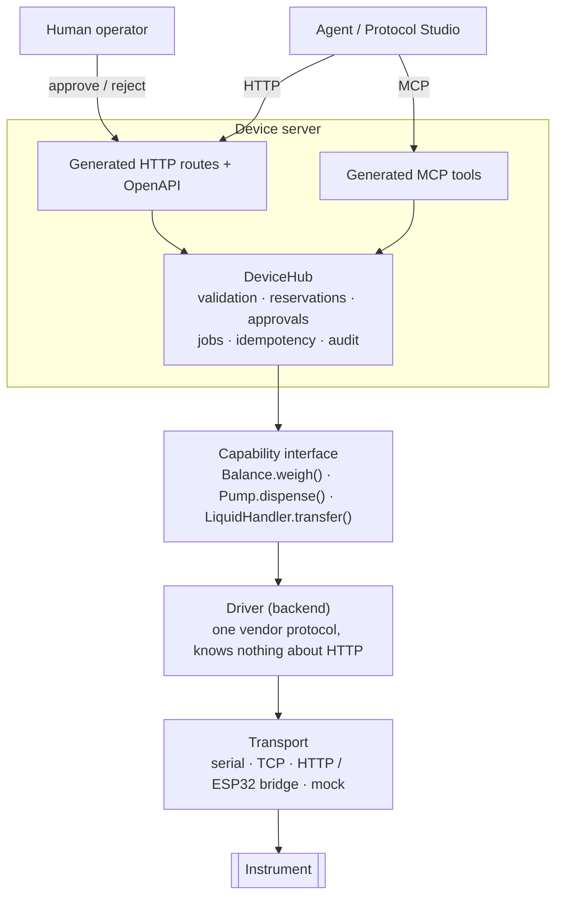
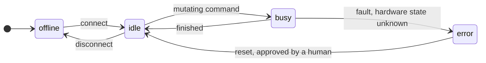
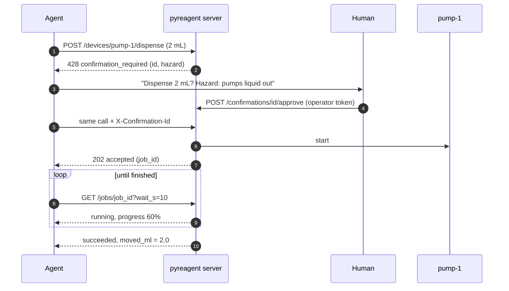

<p align="center">
  
</p>

<p align="center">
  
  
  
  
  
  
</p>

<p align="center">
  <a href="#quick-start"><b>Quick start</b></a> ·
  <a href="#how-it-works"><b>How it works</b></a> ·
  <a href="#devices"><b>Devices</b></a> ·
  <a href="#agent-safety"><b>Agent safety</b></a> ·
  <a href="#adding-a-driver"><b>Adding a driver</b></a>
</p>

---

**pyreagent** is a set of lab instrument drivers that are safe for AI agents to operate. You describe each device
once in Python, as a typed capability interface. pyreagent generates the **HTTP API**, the **OpenAPI schema** and
the **MCP tools** from that description, and it enforces the safety rules on every call: locks, limits, human
approval and an audit log.

<table>
  <tr>
    <td width="33%" valign="top">
      <h3>🧩 Write a device once</h3>
      Typed <code>@capability</code> methods become HTTP routes, OpenAPI operations and MCP tools.
      A new driver needs no hand-written endpoints.
    </td>
    <td width="33%" valign="top">
      <h3>🛡️ Safe on every call</h3>
      The server enforces limits, locks, human approval for hazardous actions, and a full audit trail.
      The agent's prompt doesn't have to.
    </td>
    <td width="33%" valign="top">
      <h3>🧪 Simulate everything</h3>
      Every device type comes with a simulated driver, so an agent's plan runs end to end before it
      touches hardware or reagents.
    </td>
  </tr>
</table>

## Quick start

```bash
uv sync                    # Python 3.12+
uv run pyreagent demo      # one simulated device of every type on http://127.0.0.1:8000
uv run pytest              # 81 tests, no hardware needed
```

Open **<http://127.0.0.1:8000/docs>** for the generated API. To let Claude Code drive the bench over MCP:

```bash
claude mcp add --transport http pyreagent http://127.0.0.1:8000/mcp --header "X-Caller: claude-code"
```

Try a gated action, as an agent would:

```bash
curl -X POST localhost:8000/devices/pump-1/dispense -H "X-Caller: agent" \
     -H "Content-Type: application/json" -d '{"volume_ml": 1, "rate_ml_min": 10}'
# -> 428 {"error": {"code": "confirmation_required", "details": {"confirmation_id": "...", "hazard": "..."}}}
```

## How it works

Each device has three layers. HTTP and MCP calls both go through a single runtime, the `DeviceHub`,
so neither path can skip a check.



| Layer | Lives in | Responsibility |
|---|---|---|
| **Capability interface** | `devices/<type>/<type>.py` | What an agent sees. Typed parameters with descriptions and limits; the docstring is the tool description. |
| **Driver (backend)** | `devices/<type>/<brand>/` | Speaks one vendor protocol over a transport. Knows nothing about HTTP, jobs or agents. |
| **Server** | `server/`, `core/hub.py` | Generated from the capability interface: routes, OpenAPI, MCP tools, and all safety checks. |

## Devices

Each device type has its own folder, with one subfolder per brand. Every type also has a `simulated/` brand.

| Type | What an agent can do | Drivers |
|---|---|---|
| ⚖️ **Balance** | `weigh` · `tare` · `zero` | simulated · Mettler Toledo (MT-SICS) |
| 💧 **Pump** | `dispense` · `withdraw` · `stop` · `status` | simulated · New Era (NE-1000) |
| 🔬 **Plate reader** | `read_absorbance` · `open_tray` · `close_tray` · `status` | simulated |
| 🌡️ **Temperature controller** | `set_temperature` · `wait_for_temperature` · `get_temperature` · `deactivate` | simulated |
| 🔄 **Shaker** | `shake` · `start_shaking` · `stop_shaking` · `status` | simulated |
| 🤖 **Liquid handler** | `transfer` · `aspirate` · `dispense` · `pick_up_tip` · `drop_tip` · `load_labware` · `get_deck` · `home` · `stop` | simulated |
| 🧬 **Thermocycler** | `run_profile` · `set_block_temperature` · `open_lid` · `close_lid` · `status` · `deactivate` | simulated |
| 📈 **qPCR** | `run_qpcr` (curves + Ct estimate), plus everything a thermocycler does | simulated |
| 🚿 **Plate washer** | `wash` · `dispense` · `prime` · `status` · `stop` | simulated |

Every device also has `reset`. It needs human approval and clears an error state.

<details>
<summary><b>Repository layout</b></summary>

```
pyreagent/
  core/            Device, Backend, @capability, DeviceHub, jobs, confirmations, audit, errors
  io/              SerialTransport, TcpTransport, HttpBridge, MockTransport
  devices/
    balance/       balance.py · backend.py · models.py
      simulated/
      mettler_toledo/        MT-SICS, serial or Ethernet
    pump/
      simulated/
      new_era/               NE-1000 family syringe pumps, RS-232
    plate_reader/            simulated/
    temperature_controller/  simulated/
    shaker/                  simulated/
    liquid_handler/          liquid_handler.py · deck.py (deck / tip / volume bookkeeping)
      simulated/             records every motion: a dry-run trace of an agent's plan
    thermocycler/            PCR programs: stages x cycles x steps, heated lid
      simulated/
    qpcr/                    extends thermocycler; adds fluorescence and a Ct estimate (analysis.py)
      simulated/
    plate_washer/            wash / dispense / prime, buffer and waste checks
      simulated/
  labware/         plates, PCR plates, reservoirs, tip racks (used to validate slot/well/plate arguments)
  server/          create_app() (FastAPI) and build_mcp_server() (MCP)
  registry/        registry service + announcer
  configs/         simulated_lab.toml (used by `pyreagent demo`)
examples/bench.toml          real-hardware config
tests/                       includes protocol-level fakes of the MT-SICS balance and NE-1000 pump
docs/assets/                 banner
```

For reference, PyLabRobot can be cloned into `_reference/`. That folder is git-ignored and not part of pyreagent.

</details>

## Agent safety

Every device reports an explicit state. Mutating commands hold the device's mutex. A fault that leaves the
hardware in an unknown state locks the device until a human resets it.



Hazardous actions (heater on, tray open, moving reagent) need a human's approval. Each approval covers one exact
set of arguments and can be used once:



| Concern | What pyreagent does |
|---|---|
| ⏱️ **Long operations** | `long_running` capabilities return `202` with a job. Poll `GET /jobs/{id}?wait_s=10` (long-poll). `POST /jobs/{id}/cancel` stops the hardware. |
| 🔒 **Two agents at once** | A second mutating call fails fast with `device_busy` and the id of the job to wait on. `reserve` holds a device across a multi-step sequence. Reads (`read_only`) and safety stops (`interrupt`) always get through. |
| 📏 **Limits** | Schema bounds (`Field(gt=0, le=120)`), per-instance bounds (`Within("min_c", "max_c")` against `limits()`), and a `validate_arguments` hook for things like labware existence. All are checked **before** a human is asked to approve. |
| 🧾 **Errors** | Always `{code, message, recoverable, suggested_action, details}`, so the agent knows whether to retry, ask a human, or stop. |
| 🔁 **Retries** | An `Idempotency-Key` header (or the `idempotency_key` MCP argument) returns the original outcome, never a second run. |
| 🙋 **Human in the loop** | Approval needs `X-Operator-Token`, isn't exposed over MCP, and can't be given by the requester. Approvals expire. Per-device overrides in config: `confirm = { dispense = false }`. |
| 📜 **Audit** | Every call, rejection, job result, approval and reservation, with time, caller, args and outcome. Available at `GET /audit` and, optionally, as a JSONL file. |
| 🧪 **Simulation** | Every type has a `simulated` driver. Real drivers are tested against protocol fakes through `MockTransport`. |

<details>
<summary><b>What each device type refuses before asking a human</b></summary>

| Type | Refused up front |
|---|---|
| `liquid_handler` | The server tracks the deck: labware per slot, liquid per well, used tips, and what each tip holds. A `transfer` is dry-run against that state, so these are refused up front: not enough liquid in a source, a destination that would overflow, too few compatible tips, an empty slot, the wrong labware kind, below-minimum volumes, and 8-channel positions outside row A. Volumes above the tip size are split into several trips. A `stop` or cancel mid-motion puts the robot in `error` until a human resets it. |
| `thermocycler` / `qpcr` | Every step and the final hold must be within `min_c`..`max_c`. The lid temperature must not exceed `max_lid_c`, and the cycle count must not exceed `max_cycles`. For qPCR, the plate must match the block format, channels must exist, and at least one step must set `acquire`. Runs refuse to start with the lid open. `deactivate` cancels a running program. |
| `plate_washer` | The buffer bottle must exist, the plate format must fit the manifold, columns must be in range, and the volume must fit both the well and the dispenser. Before running, it checks for buffer left and room in the waste bottle (`needs_attention` if not). |
| `pump`, `temperature_controller`, `shaker`, `plate_reader` | Volume, rate, temperature, rpm and wavelength must be within the device's configured limits. The plate must exist and be a plate. Requested wells must exist. |

qPCR Ct values are a simple baseline/threshold estimate (`devices/qpcr/analysis.py`). Use the vendor's
software for results you report.

</details>

## Registry and discovery

```bash
uv run pyreagent registry --port 9000        # on one machine
# in each device server's config: registry_url + public_url
curl "http://registry:9000/devices?type=pump"
```

Device servers re-announce themselves every `heartbeat_s`. A server that stops announcing is shown as `stale`
and is later dropped. Each device entry carries its `device_url` and `mcp_url`, so the orchestrator never
hard-codes addresses.

## Configuration

A device server is one TOML file. See [`examples/bench.toml`](examples/bench.toml).

```toml
[[devices]]
name = "balance-1"
type = "balance"                                     # folder under pyreagent/devices/
driver = "mettler_toledo"                            # brand folder, or "pkg.module:Class"
driver_options = { port = "COM3", baudrate = 9600 }  # passed to the driver
options = {}                                         # passed to the device (limits etc.)
```

```bash
export PYREAGENT_OPERATOR_TOKEN=...   # only humans holding this can approve gated actions
uv run pyreagent serve examples/bench.toml
```

## Adding a driver

**For a new brand of an existing type:**

1. Create `pyreagent/devices/<type>/<brand>/` containing `__init__.py` and a driver module.
2. Subclass that type's backend (for example `BalanceBackend`) and implement its abstract methods.
   Take a `transport` argument so tests can inject `MockTransport`.
3. Translate the vendor's status and error replies into `pyreagent.core.errors`.
   Use `NeedsAttention` for physical-setup problems, `HardwareError` when the state is unknown,
   and `InvalidArgument` for out-of-range values.
4. Export `DRIVER = YourBackend` in `__init__.py`. Config can then say `driver = "<brand>"`.
5. Add a protocol fake to `tests/fakes.py` and tests under `tests/drivers/`.

Drivers that live outside this repo also work: set `driver = "my_lab.drivers:MyBackend"`.

**For a new device type:** create `devices/<type>/` containing `models.py`, `backend.py` (an abstract
`Backend` subclass), `<type>.py` (a `Device` subclass whose methods use `@capability`), and `simulated/`.
Then register the type in `devices/DEVICE_TYPES`.

- A type can extend another (`Qpcr(Thermocycler)`) and inherit its capabilities.
- Checks that need no hardware go in `validate_arguments`, so they run before approval.
- `tests/test_capabilities.py` fails if a capability or parameter has no description, or if a gated
  capability has no hazard text.

## Driver status

| Driver | Status |
|---|---|
| `*/simulated` (all 9 types) | ✅ complete |
| `balance/mettler_toledo` (MT-SICS level 0/1: `@ I2 S SI T Z`) | 🧪 written from the MT-SICS reference and tested against a protocol fake. **Not yet run on a real balance.** |
| `pump/new_era` (NE-1000 basic RS-232 mode) | 🧪 written from the NE-1000 manual and tested against a protocol fake. **Not yet run on a real pump.** |
