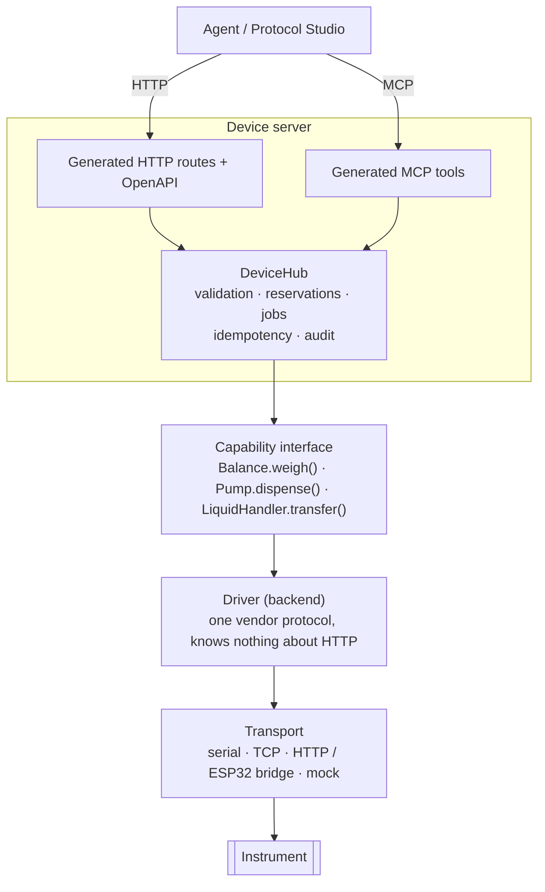
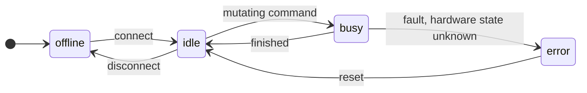
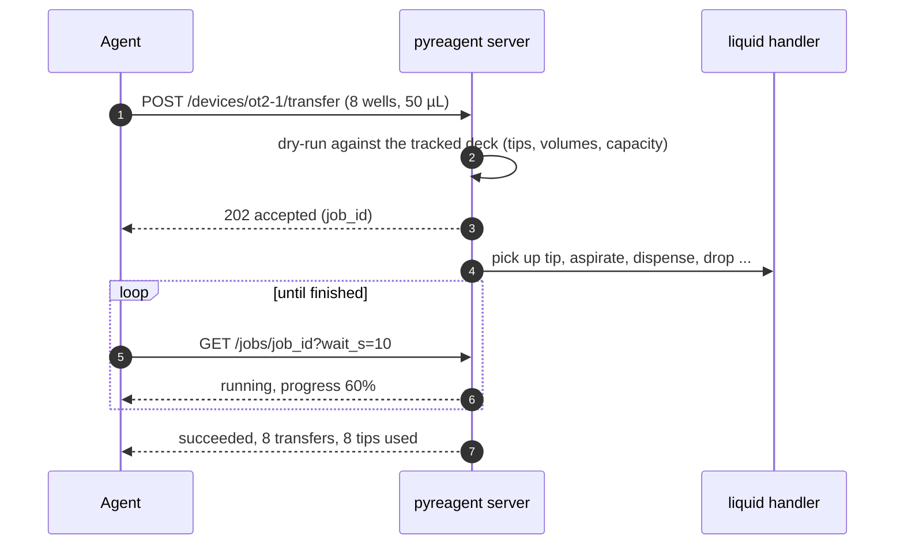

<p align="center">
  
</p>

<p align="center">
  
  
  
  
  
  
  
  
  
</p>

<p align="center">
  <a href="#quick-start"><b>Quick start</b></a> ·
  <a href="#how-it-works"><b>How it works</b></a> ·
  <a href="#devices"><b>Devices</b></a> ·
  <a href="#agent-safety"><b>Agent safety</b></a> ·
  <a href="#opentrons-ot-2-and-flex"><b>Opentrons</b></a> ·
  <a href="#hamilton-star-and-tecan-freedom-evo"><b>Hamilton &amp; Tecan</b></a> ·
  <a href="#adding-a-driver"><b>Adding a driver</b></a>
</p>

---

**pyreagent** is a set of lab instrument drivers that are safe for AI agents to operate. You describe each device
once in Python, as a typed capability interface. pyreagent generates the **HTTP API**, the **OpenAPI schema** and
the **MCP tools** from that description, and it enforces the rules on every call: limits checked before anything
moves, one command at a time per device, structured errors and an audit log.

<table>
  <tr>
    <td width="33%" valign="top">
      <h3>🧩 Write a device once</h3>
      Typed <code>@capability</code> methods become HTTP routes, OpenAPI operations and MCP tools.
      A new driver needs no hand-written endpoints.
    </td>
    <td width="33%" valign="top">
      <h3>🛡️ Checked before it moves</h3>
      The server dry-runs each call against limits and tracked state (volumes, tips, labware). It
      refuses impossible plans with errors an agent can act on, and keeps a full audit trail.
    </td>
    <td width="33%" valign="top">
      <h3>🧪 Simulate everything</h3>
      Every device type comes with a simulated driver, so an agent's plan runs end to end before it
      touches hardware or reagents.
    </td>
  </tr>
</table>

## Quick start

```bash
uv sync                    # Python 3.12+
uv run pyreagent demo      # one simulated device of every type on http://127.0.0.1:8000
uv run pytest              # 123 tests, no hardware needed
```

Open **<http://127.0.0.1:8000/docs>** for the generated API. To let Claude Code drive the bench over MCP:

```bash
claude mcp add --transport http pyreagent http://127.0.0.1:8000/mcp --header "X-Caller: claude-code"
```

Start a long-running action and poll it, as an agent would:

```bash
curl -X POST localhost:8000/devices/pump-1/dispense -H "X-Caller: agent" \
     -H "Content-Type: application/json" -d '{"volume_ml": 1, "rate_ml_min": 10}'
# -> 202 {"status": "accepted", "job": {"id": "...", "status": "running", ...}}
curl "localhost:8000/jobs/<id>?wait_s=10"
```

## How it works

Each device has three layers. HTTP and MCP calls both go through a single runtime, the `DeviceHub`,
so neither path can skip a check.



| Layer | Lives in | Responsibility |
|---|---|---|
| **Capability interface** | `devices/<type>/<type>.py` | What an agent sees. Typed parameters with descriptions and limits; the docstring is the tool description. |
| **Driver (backend)** | `devices/<type>/<brand>/` | Speaks one vendor protocol over a transport. Knows nothing about HTTP, jobs or agents. |
| **Server** | `server/`, `core/hub.py` | Generated from the capability interface: routes, OpenAPI, MCP tools, and all checks. |

## Devices

Each device type has its own folder, with one subfolder per brand. Every type also has a `simulated/` brand.

| Type | What an agent can do | Drivers |
|---|---|---|
| ⚖️ **Balance** | `weigh` · `tare` · `zero` | simulated · Mettler Toledo (MT-SICS) |
| 💧 **Pump** | `dispense` · `withdraw` · `stop` · `status` | simulated · New Era (NE-1000) |
| 🔬 **Plate reader** | `read_absorbance` · `open_tray` · `close_tray` · `status` | simulated |
| 🌡️ **Temperature controller** | `set_temperature` · `wait_for_temperature` · `get_temperature` · `deactivate` | simulated · Opentrons Temperature Module (via robot or USB) |
| 🔄 **Shaker** | `shake` · `start_shaking` · `stop_shaking` · `status` | simulated |
| 🤖 **Liquid handler** | `transfer` · `aspirate` · `dispense` · `blow_out` · `touch_tip` · `mix` · `pick_up_tip` (incl. partial tips) · `drop_tip` · `return_tip` · `move_labware` · `probe_liquid_heights` · `load_labware` · `get_deck` · `move_to` · `set_lights` · `home` · `stop` | simulated · Opentrons OT-2 / Flex · Hamilton STAR / STARlet · Tecan Freedom EVO |
| 🧬 **Thermocycler** | `run_profile` · `set_block_temperature` · `open_lid` · `close_lid` · `lift_plate` · `status` · `deactivate` | simulated · Opentrons Thermocycler (via robot or USB) |
| 📈 **qPCR** | `run_qpcr` (curves + Ct estimate), plus everything a thermocycler does | simulated |
| 🚿 **Plate washer** | `wash` · `dispense` · `prime` · `status` · `stop` | simulated |

Every device also has `reset`, which clears an error state. Drivers declare optional hardware features (for
example `gripper`, `liquid_probe`, `nozzle_layouts`, `ramp_rate`). They're listed in each device's `limits` in
`GET /devices`, and a call that needs a missing feature is refused with `not_supported` before anything moves.

<details>
<summary><b>Repository layout</b></summary>

```
pyreagent/
  core/            Device, Backend, @capability, DeviceHub, jobs, audit, errors
  io/              SerialTransport, TcpTransport, HttpBridge, UsbBulkTransport, mock transports
  vendors/
    opentrons/     shared by every Opentrons driver: HTTP client, shared run (session),
                   pipette flow-rate tables, Flex deck configuration, labware JSON, mDNS discovery
    hamilton/      STAR firmware text protocol, deck (tracks, carriers, CO-RE tip racks), water liquid classes
    tecan/         EVO firmware protocol, worktable (rails, carriers, Tecan labware), water liquid classes
  devices/
    balance/       balance.py · backend.py · models.py
      simulated/
      mettler_toledo/        MT-SICS, serial or Ethernet
    pump/
      simulated/
      new_era/               NE-1000 family syringe pumps, RS-232
    plate_reader/            simulated/
    temperature_controller/
      simulated/
      opentrons/             Temperature Module: robot.py (through the robot) · usb.py (direct)
    shaker/                  simulated/
    liquid_handler/          liquid_handler.py · deck.py (deck / tip / volume bookkeeping) · nozzles.py (partial tips)
      simulated/             records every motion: a dry-run trace of an agent's plan
      opentrons/             OT-2 and Flex over the robot's HTTP API
      hamilton/              STAR / STARlet firmware over USB: channels, CO-RE 96 head, iSWAP
      tecan/                 Freedom EVO firmware over USB: LiHa, RoMa
                             (positions.py: well coordinates for these coordinate-driven robots)
    thermocycler/            PCR programs: stages x cycles x steps, heated lid
      simulated/
      opentrons/             Thermocycler Module: robot.py (through the robot) · usb.py (direct, GEN1/GEN2)
    qpcr/                    extends thermocycler; adds fluorescence and a Ct estimate (analysis.py)
      simulated/
    plate_washer/            wash / dispense / prime, buffer and waste checks
      simulated/
  labware/         plates, PCR plates, reservoirs, tip racks, tube racks (validate slot/well/plate arguments)
                   opentrons_standard.py: 36 Opentrons labware under their load names (generated)
  server/          create_app() (FastAPI) and build_mcp_server() (MCP)
  registry/        registry service + announcer
  configs/         simulated_lab.toml (used by `pyreagent demo`)
scripts/gen_opentrons_labware.py   regenerates the Opentrons labware catalog
examples/bench.toml          real-hardware config
tests/                       protocol-level fakes: MT-SICS balance, NE-1000 pump, Opentrons robot-server and module
                             firmware, Hamilton STAR and Tecan EVO firmware
docs/assets/                 banner
```

For reference, PyLabRobot and Opentrons can be cloned into `_reference/`. That folder is git-ignored and not part of pyreagent.

</details>

## Agent safety

Every device reports an explicit state. Mutating commands hold the device's mutex. A fault that leaves the
hardware in an unknown state locks the device until it is reset.



Long operations run as jobs that the agent polls:



| Concern | What pyreagent does |
|---|---|
| ⏱️ **Long operations** | `long_running` capabilities return `202` with a job. Poll `GET /jobs/{id}?wait_s=10` (long-poll). `POST /jobs/{id}/cancel` stops the hardware. |
| 🔒 **Two agents at once** | A second mutating call fails fast with `device_busy` and the id of the job to wait on. `reserve` holds a device across a multi-step sequence. Reads (`read_only`) and safety stops (`interrupt`) always get through. |
| 📏 **Limits** | Schema bounds (`Field(gt=0, le=120)`), per-instance bounds (`Within("min_c", "max_c")` against `limits()`), and a `validate_arguments` hook for things like labware existence. All are checked **before** anything moves. |
| 🧾 **Errors** | Always `{code, message, recoverable, suggested_action, details}`, so the agent knows whether to retry, ask a human, or stop. |
| 🔁 **Retries** | An `Idempotency-Key` header (or the `idempotency_key` MCP argument) returns the original outcome, never a second run. |
| 📜 **Audit** | Every call, rejection, job result and reservation, with time, caller, args and outcome. Available at `GET /audit` and, optionally, as a JSONL file. |
| 🧪 **Simulation** | Every type has a `simulated` driver. Real drivers are tested against protocol fakes. |

<details>
<summary><b>What each device type refuses before anything moves</b></summary>

| Type | Refused up front |
|---|---|
| `liquid_handler` | The server tracks the deck: labware per slot, liquid per well, used tips, what each tip holds, and the active nozzle layout. A `transfer` is dry-run against that state. These are refused up front: not enough liquid in a source, a destination that would overflow, too few compatible tips, an empty slot, the wrong labware kind, below-minimum volumes, and positions where the active nozzles don't fit. With partial tips, a pickup is also refused if the unused nozzles would land on tips that are still in the rack. Volumes above the tip size are split into several trips. A `stop` or cancel mid-motion puts the robot in `error` until it's reset. |
| `thermocycler` / `qpcr` | Every step and the final hold must be within `min_c`..`max_c`. The lid temperature must not exceed `max_lid_c`, and the cycle count must not exceed `max_cycles`. Ramp rates need the `ramp_rate` feature. For qPCR, the plate must match the block format, channels must exist, and at least one step must set `acquire`. Runs refuse to start with the lid open. `deactivate` cancels a running program. |
| `plate_washer` | The buffer bottle must exist, the plate format must fit the manifold, columns must be in range, and the volume must fit both the well and the dispenser. Before running, it checks for buffer left and room in the waste bottle (`needs_attention` if not). |
| `pump`, `temperature_controller`, `shaker`, `plate_reader` | Volume, rate, temperature, rpm and wavelength must be within the device's configured limits. The plate must exist and be a plate. Requested wells must exist. |

qPCR Ct values are a simple baseline/threshold estimate (`devices/qpcr/analysis.py`). Use the vendor's
software for results you report.

</details>

## Opentrons OT-2 and Flex

The Opentrons drivers talk to the robot's own HTTP API on port 31950, so you don't need to install the Opentrons
Python package or upload a protocol. The commands they send are checked in the tests against Opentrons'
official command schema.

```toml
[[devices]]
name = "ot2-1"
type = "liquid_handler"
driver = "opentrons"
driver_options = { host = "192.168.1.50", robot = "ot2" }   # robot = "flex" for a Flex; host = "auto" to find it

[devices.options.deck]
"1" = "opentrons_96_tiprack_300ul"
"3" = { labware = "nest_12_reservoir_15ml", initial_volume_ul = 12000 }
"7" = { labware = "opentrons_96_wellplate_200ul_pcr_full_skirt", initial_volume_ul = 0 }   # on the thermocycler

[[devices]]
name = "ot2-tc"
type = "thermocycler"
driver = "opentrons"
driver_options = { host = "192.168.1.50", robot = "ot2" }
```

| Feature | OT-2 | Flex | How |
|---|:-:|:-:|---|
| Pipetting, 1- and 8-channel; Opentrons' default flow rates per pipette and tip | ✅ | ✅ | `aspirate` / `dispense` with the published rates |
| 96-channel head | | ✅ | full plate, column, row or single-tip layouts |
| Partial tip pickup | ✅ ¹ | ✅ | `nozzles = {style = "single"}` or `{style = "partial_column", nozzles = 3}` |
| Blow out, touch tip, mix, return tips, move to a well | ✅ | ✅ | `blowout`, `touchTip`, `dropTip` into the rack, `moveToWell` |
| Tip-presence checks after pickup and drop | | ✅ | `verifyTipPresence` |
| Liquid-level probing (mm above the well bottom) | | ✅ | `tryLiquidProbe` + labware well depth |
| 50 µL low-volume mode below 5 µL | | ✅ | `configureForVolume`, automatically |
| Gripper moves | | ✅ | `move_labware`; with `use_gripper=false` a human moves it and the robot is told |
| Deck configuration: trash bins, staging slots A4–D4, waste chute | | ✅ | read from the robot on connect |
| Thermocycler Module (GEN1/GEN2) | ✅ | ✅ | its own device; ramp rates; profiles stepped from the host (or `native_profiles = true`) |
| Temperature Module | ✅ | ✅ | its own device |
| Same modules directly over USB, no robot | ✅ | ✅ | `driver = "opentrons.usb:..."` with `port = "COM7"`; GEN2 plate lift |
| Custom labware (Labware Creator JSON) | ✅ | ✅ | `labware_definitions = ["path.json"]` |
| Labware Position Check offsets saved on the robot | ✅ ² | ✅ ² | applied as each labware is loaded or moved; `use_stored_offsets = false` to skip |
| Find robots on the network | ✅ | ✅ | `pyreagent discover`, or `host = "auto"` (`pip install 'pyreagent[opentrons]'`) |
| Deck lights | ✅ | ✅ | `set_lights` |

¹ Needs robot software 8.0 or newer. With older software the driver reports no `nozzle_layouts` feature.
² Needs robot software 8.4 or newer. Run Labware Position Check from the Opentrons App or touchscreen; the driver
uses the offset saved for that labware in that slot, else the labware's default offset, as the App does.

- **What happens on connect.** The pipettes and every module on one robot are separate pyreagent devices that
  share a single run on the robot (`vendors/opentrons/session.py`). The run is created when the first device
  connects. While it's open, the Opentrons App sees the robot as busy. If the App already has an active run,
  the devices stay `offline` with `needs_attention`.
- **Labware on a module.** Labware in a module's slot is loaded onto the module. Slots a module covers, such
  as OT-2 slots 8, 10 and 11 under the Thermocycler, are refused.
- **Homing.** Call `home` after the robot powers up. Until then, motions fail with `needs_attention`. When the
  last device on a robot disconnects, the run is released and the gantry and pipettes are homed
  (`home_after_run = false` to leave them where they are).
- **Stopping.** `stop` halts the whole robot. Devices that were moving go to `error`. The next `reset` starts a
  fresh run, and every device on the robot reloads into it automatically.
- **Labware names.** Declare labware by its Opentrons load name. The 36 most common Opentrons labware are in
  the catalog (`GET /labware`). You can map your own ids with `load_names`. Each loads in the definition version
  the Opentrons Protocol API uses by default (stored offsets are per version), or version 1 on robot software
  that doesn't have it yet.
- **Not supported yet:** running Labware Position Check itself, Heater-Shaker, Magnetic Module/Block, the Flex
  Absorbance Plate Reader, and running protocol files. Reach limits are left to the robot, which rejects
  positions it can't reach.

The liquid handler driver has been run on a Flex (software 10.1.0; P1000 single and P50 8-channel): connect,
lights, home, tip pickup and drop with tip-sensor checks, moving to a well, aspirating and dispensing with the
single-channel pipette, stored labware offsets, and releasing and homing the robot on disconnect.
The 8-channel pipette, liquid probing, the OT-2 and the module drivers have not been run on physical hardware yet. They're built from
Opentrons' own source and tested against fakes of the robot-server and the module firmware. A Flex config for
hardware tests is in [`examples/flex.toml`](examples/flex.toml).

## Hamilton STAR and Tecan Freedom EVO

These drivers talk to the instrument firmware directly over USB, so neither Venus nor EVOware is needed. The vendor
software must not be connected at the same time. We worked out the protocols by studying PyLabRobot's
reverse-engineered backends, then wrote our own code. The tests check the commands we send against the strings
PyLabRobot's own tests expect.

```bash
pip install 'pyreagent[usb]'
```

On Windows, bind the instrument to the WinUSB or libusbK driver with [Zadig](https://zadig.akeo.ie/). Until you
switch it back, Venus or EVOware can't use the instrument.

```toml
[[devices]]
name = "starlet-1"
type = "liquid_handler"
driver = "hamilton"
[devices.driver_options]
model = "starlet"                       # or "star"; checked against the instrument on connect
carriers = { tips = { type = "TIP_CAR_480_A00", track = 1 }, plates = { type = "PLT_CAR_L5AC_A00", track = 9 } }
[devices.options.deck]                  # slots are "<carrier>.<site>", sites numbered from the front
"tips.1" = "hamilton_96_tiprack_300ul_filter"
"plates.1" = { labware = "corning_96_wellplate_360ul_flat", initial_volume_ul = 200 }
```

The Tecan driver is set up the same way, with `driver = "tecan"`, `model = "evo150"` and carriers on `rail`s.

| Feature | Hamilton STAR / STARlet | Tecan Freedom EVO |
|---|:-:|:-:|
| 8 independent channels; single, partial-column and full-column pickups | ✅ | ✅ (LiHa) |
| Vendor water liquid classes: volume correction, flow rates, air gaps | ✅ per tip size, filter, jet/surface | ✅ DiTi classes |
| Liquid level detection while aspirating | ✅ `lld = "capacitive"` or `"pressure"` | ✅ always |
| `probe_liquid_heights` | ✅ capacitive (conductive tips) | |
| Return tips to the rack, move over a well | ✅ | ✅ |
| 96 head | ✅ CO-RE 96: whole racks and plates (`pipette = "core96"`) | MCA is only initialised and parked |
| Plate gripper (`move_labware`) | ✅ iSWAP | ✅ RoMa |
| Carriers | `TIP_CAR_480_A00`, `PLT_CAR_L5AC_A00`, `PLT_CAR_L5MD_A00` | `MP_3Pos`, `MP_3Pos_PCR`, `DiTi_3Pos`, `DiTi_SBS_3_Pos_MCA96` |
| Tips | Hamilton CO-RE racks: 10, 50, 300 and 1000 µL, with or without filter | `tecan_diti_*` racks |
| Plates | any labware with geometry | `tecan_*` labware, or your own with `labware_params` |

- **Start-up.** The STAR reads its configuration on connect: channels, iSWAP, CO-RE 96 head and deck size.
  If the instrument isn't initialised, or tips are still on the channels, it initialises the channels over the
  tip waste, which ejects those tips.
- **Heights on Hamilton plate carriers.** A plate stands on the carrier's pedestal by its well bottoms. For your
  own labware, set `well_floor_mm` (the material under the wells) in its geometry to get exact heights. Without
  it, the height pyreagent calculates can be up to that thickness below the real well bottom. The default
  `bottom_clearance_mm = 1` covers typical plates.
- **Blow-out.** With `blow_out = true` (the default), the tip takes up blow-out air when it aspirates and blows
  it out when a dispense empties it. Partial dispenses leave that air in the tip.
- **Not supported yet:** 4- and 16-channel STARs, autoload, CO-RE grippers, plate lids, Tecan MCA pipetting and
  4-channel LiHas. `stop` can't abort a firmware command already in flight on either robot. pyreagent
  stops sending further commands instead.

Neither driver has been run on a physical instrument yet. PyLabRobot marks some EVO constants as unverified:
the y origins, the µL-to-step factors and the tip z offset. Those are driver options rather than fixed values.

## Registry and discovery

```bash
uv run pyreagent registry --port 9000        # on one machine
# in each device server's config: registry_url + public_url
curl "http://registry:9000/devices?type=pump"
```

Device servers re-announce themselves every `heartbeat_s`. A server that stops announcing is shown as `stale`
and is later dropped. Each device entry carries its `device_url` and `mcp_url`, so the orchestrator never
hard-codes addresses.

## Configuration

A device server is one TOML file. See [`examples/bench.toml`](examples/bench.toml).

```toml
[[devices]]
name = "balance-1"
type = "balance"                                     # folder under pyreagent/devices/
driver = "mettler_toledo"                            # brand folder, or "pkg.module:Class"
driver_options = { port = "COM3", baudrate = 9600 }  # passed to the driver
options = {}                                         # passed to the device (limits etc.)
```

```bash
export PYREAGENT_OPERATOR_TOKEN=...   # protects connect/disconnect and force-releasing reservations
uv run pyreagent serve examples/bench.toml
```

## Adding a driver

**For a new brand of an existing type:**

1. Create `pyreagent/devices/<type>/<brand>/` containing `__init__.py` and a driver module.
2. Subclass that type's backend (for example `BalanceBackend`) and implement its abstract methods.
   Declare optional hardware in `features`, and override only those optional methods.
   Take a `transport` argument so tests can inject a mock.
3. Translate the vendor's status and error replies into `pyreagent.core.errors`.
   Use `NeedsAttention` for physical-setup problems, `HardwareError` when the state is unknown,
   and `InvalidArgument` for out-of-range values.
4. Export `DRIVER = YourBackend` in `__init__.py`. Config can then say `driver = "<brand>"`.
5. Add a protocol fake to `tests/` and tests under `tests/drivers/`.

Drivers that live outside this repo also work: set `driver = "my_lab.drivers:MyBackend"`. Code that several of
one vendor's drivers share goes in `pyreagent/vendors/<vendor>/`.

**For a new device type:** create `devices/<type>/` containing `models.py`, `backend.py` (an abstract
`Backend` subclass), `<type>.py` (a `Device` subclass whose methods use `@capability`), and `simulated/`.
Then register the type in `devices/DEVICE_TYPES`.

- A type can extend another (`Qpcr(Thermocycler)`) and inherit its capabilities.
- Checks that need no hardware go in `validate_arguments`, so they run before anything moves.
- `tests/test_capabilities.py` fails if a capability or parameter has no description.

## Driver status

| Driver | Status |
|---|---|
| `*/simulated` (all 9 types) | ✅ complete |
| `balance/mettler_toledo` (MT-SICS level 0/1: `@ I2 S SI T Z`) | 🧪 written from the MT-SICS reference and tested against a protocol fake. **Not yet run on a real balance.** |
| `pump/new_era` (NE-1000 basic RS-232 mode) | 🧪 written from the NE-1000 manual and tested against a protocol fake. **Not yet run on a real pump.** |
| `liquid_handler/opentrons` (OT-2 and Flex, HTTP API) | 🧪 built from Opentrons' robot-server and protocol-engine source. Tested against a fake robot-server, and every command type is validated against the official schema. **Flex: connect, home, tips, moves, single-channel aspirate/dispense and stored labware offsets run on hardware; 8-channel not yet. OT-2 not yet run.** |
| `liquid_handler/hamilton` (STAR / STARlet, firmware over USB) | 🧪 written from PyLabRobot's reverse-engineered STAR backend. Tested against a fake firmware: tip handling, aspirate, dispense, CO-RE 96 and iSWAP commands match the strings PyLabRobot's tests expect. **Not yet run on a physical STAR.** |
| `liquid_handler/tecan` (Freedom EVO, firmware over USB) | 🧪 written the same way and tested against a fake firmware with PyLabRobot's expected strings. Constants PyLabRobot marks unverified are driver options. **Not yet run on a physical EVO.** |
| `thermocycler/opentrons` (robot and USB, GEN1/GEN2) | 🧪 built from Opentrons' module commands and firmware driver, and tested against fakes. **Not yet run on a physical module.** |
| `temperature_controller/opentrons` (robot and USB) | 🧪 as above. **Not yet run on a physical module.** |
